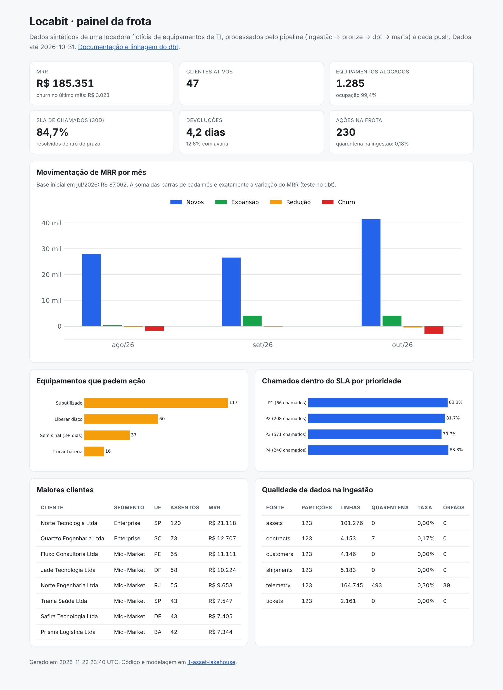
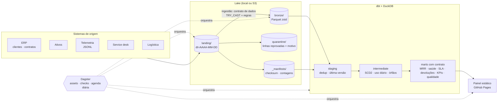

<div align="center">

# IT Asset Lakehouse

**Plataforma de dados de ponta a ponta para uma locadora de equipamentos de TI: ingestão idempotente com contrato e quarentena, lakehouse em Parquet, modelagem em dbt com SCD2 e movimentação de MRR, orquestração com Dagster, qualidade de dados como código e infraestrutura na AWS com Terraform.**

[](https://github.com/lucassantana2301-bot/it-asset-lakehouse/actions/workflows/ci.yml)
[](https://github.com/lucassantana2301-bot/it-asset-lakehouse/actions/workflows/codeql.yml)
[](https://lucassantana2301-bot.github.io/it-asset-lakehouse/coverage/)
[](https://github.com/lucassantana2301-bot/it-asset-lakehouse/releases)


**[📊 Painel ao vivo](https://lucassantana2301-bot.github.io/it-asset-lakehouse/)** · [Documentação e linhagem do dbt](https://lucassantana2301-bot.github.io/it-asset-lakehouse/dbt/) · [Abrir no Codespaces](https://codespaces.new/lucassantana2301-bot/it-asset-lakehouse?quickstart=1) · [Decisões](#decisões-técnicas)



</div>

## O problema

A **Locabit** (empresa fictícia) aluga notebooks, desktops e monitores para outras empresas. Os dados que respondem às perguntas do negócio estão espalhados em cinco sistemas, cada um com seu formato e seus defeitos:

| Sistema | Entrega | Problemas reais simulados |
| --- | --- | --- |
| ERP: clientes e contratos | CSV, foto completa diária | chave nula, mudanças de contrato sem histórico |
| Gestão de ativos | CSV, foto completa diária | equipamento que muda de estado várias vezes |
| Agente de telemetria | JSONL, eventos do dia | eventos duplicados, atrasados, fora da faixa e de equipamento desconhecido |
| Service desk | JSONL, cada mudança de estado | o mesmo chamado chega várias vezes |
| Logística reversa | CSV, cada movimentação | coleta e recebimento chegam em dias diferentes |

As perguntas: **quanto entra de receita recorrente e por que ela muda?** Quais equipamentos precisam de troca de bateria, estão parados ou subutilizados? O suporte cumpre o SLA? Quanto tempo leva uma devolução e quanto volta com avaria? **E dá para confiar nesses números?**

## Arquitetura



**No Dagster**, cada etapa é um asset com linhagem ponta a ponta: `landing_extracts` → `bronze/<fonte>` (6 assets, cada um com checagem de quarentena) → 18 modelos do dbt (os ~70 testes do dbt viram asset checks) → `fleet_report`. A agenda roda todo dia às 6h (horário de Brasília).

**Na AWS** ([`infra/terraform`](infra/terraform)), o mesmo layout vive num bucket S3. Os recursos:
- KMS com rotação, versionamento, logs de acesso, TLS obrigatório e ciclo de vida por camada;
- Glue Data Catalog e workgroup do Athena com limite de bytes por consulta;
- papel IAM de menor privilégio, assumido pelo GitHub Actions via **OIDC**, sem chave de acesso guardada em secret.

## Modelagem

| Camada | Modelo | O que resolve |
| --- | --- | --- |
| staging | `stg_telemetry` | Deduplica por `event_id` entre partições; a data vem de `event_ts`, não do arquivo (eventos atrasados). |
| staging | `stg_tickets`, `stg_shipments` | Mantém só o estado mais recente de cada chamado ou envio. |
| intermediate | `int_contract_history` | **SCD tipo 2 reconstruído das fotos diárias** (*gaps and islands*): cada sequência de dias com o mesmo estado vira uma versão com `valid_from`/`valid_to`. |
| intermediate | `int_customer_mrr_monthly` | MRR de cada cliente no fechamento do mês, consultando a versão do contrato vigente naquela data. |
| marts | `fct_mrr_movements` | Movimentação mensal: novo, expansão, redução, churn e reativação. |
| marts | `fct_asset_health` | p95 de CPU, tendência da bateria (`regr_slope`), disco e dias sem sinal → ação recomendada. |
| marts | `fct_ticket_sla`, `fct_reverse_logistics` | SLA por prioridade e ciclo da devolução (pedido → coleta → galpão). |
| marts | `rpt_fleet_kpis`, `rpt_data_quality` | KPIs do painel e qualidade por fonte (quarentena, órfãos, frescor). |

Os marts têm **contrato de schema obrigatório** (`contract: enforced`). Mudança de tipo ou coluna quebra o build, não o painel.

## Qualidade de dados em três camadas

1. **Na entrada (contrato de dados):** cada fonte tem colunas, tipos e regras em [`contracts.py`](src/lakehouse/contracts.py). Linha que não converte para o tipo, sem campo obrigatório ou fora da regra (CPU acima de 100%, fechamento antes da abertura) vai para `quarantine/` com o valor original e o motivo. O resto segue: dado ruim não derruba o pipeline.
2. **Na transformação (dbt):** ~70 testes, entre eles:
   - `unique`, `not_null`, `relationships` e `accepted_values`;
   - genéricos próprios: `non_negative`, `between`, `valid_interval`, `unique_combination`;
   - singulares: **o MRR reconcilia**, porque a soma das movimentações é exatamente a variação do total; e **versões SCD2 não se sobrepõem**, com uma vigente por contrato.
3. **Na orquestração:** checagens de asset no Dagster (quarentena abaixo de 5% por fonte) e `dbt source freshness` no CI.

Resultado da execução de referência (123 dias):
- 281.664 linhas lidas;
- 500 linhas em quarentena (0,18%);
- 39 eventos de telemetria de equipamentos fora do inventário, sinalizados como aviso.

## Como rodar

Pré-requisito: [uv](https://docs.astral.sh/uv/). Sem instalar nada: [](https://codespaces.new/lucassantana2301-bot/it-asset-lakehouse?quickstart=1)

```bash
uv sync
uv run lakehouse run              # gera 123 dias, ingere, roda o dbt e grava site/index.html (~40 s)
uv run dagster dev                # mesmo pipeline como assets, em http://localhost:3000
```

Passo a passo:

```bash
uv run lakehouse generate --days 30          # extratos em data/landing/<fonte>/dt=.../
uv run lakehouse ingest                      # bronze + quarentena + manifestos (idempotente)
uv run lakehouse ingest --source telemetry --force
uv run dbt build --project-dir dbt --profiles-dir dbt
uv run lakehouse report
```

Os caminhos são configuráveis por `LANDING_ROOT`, `LAKE_ROOT`, `DBT_DUCKDB_PATH` e `SITE_ROOT`. No dbt, o target `aws` lê o lake direto do S3 (`LAKE_ROOT=s3://<bucket>`), com credenciais pela cadeia padrão da AWS.

### Infraestrutura

```bash
cd infra/terraform
cp terraform.tfvars.example terraform.tfvars
terraform init && terraform plan
```

Saídas: o bucket do lake, o ARN do papel para o `aws-actions/configure-aws-credentials`, o workgroup do Athena e os bancos do Glue.

## Decisões técnicas

| Decisão | Motivo |
| --- | --- |
| **DuckDB + Parquet local-first** ([ADR 0001](docs/adr/0001-duckdb-parquet-local-first.md)) | O pipeline inteiro roda em 40 s num notebook e no CI, sem cluster. O layout é o mesmo no S3, então a migração para Athena, Spark ou um warehouse é troca de motor, não de modelo. |
| **Quarentena em vez de falhar o lote** ([ADR 0002](docs/adr/0002-quarentena-em-vez-de-falhar-o-lote.md)) | Uma linha com CPU de 340% não pode atrasar o painel do dia. Ela é isolada com o motivo, contada e monitorada; o limite de 5% vira alerta. |
| **SCD2 a partir das fotos diárias** ([ADR 0003](docs/adr/0003-scd2-a-partir-das-fotos-diarias.md)) | `dbt snapshot` só guarda o histórico a partir do momento em que começa a rodar. Como o bronze guarda todas as fotos, o histórico é reconstruível e reprocessável a qualquer momento. |
| **Assets no Dagster, não tarefas** ([ADR 0004](docs/adr/0004-orquestracao-por-assets.md)) | O que importa é o dado (bronze, marts), não o passo. A linhagem e as checagens ficam no mesmo grafo, e o dbt entra como assets sem duplicar a definição. |
| **Partição substituída de forma atômica** | Reprocessar um dia grava num arquivo temporário e troca no fim: nunca duplica e nenhum leitor vê Parquet pela metade. O checksum no manifesto evita retrabalho. |
| **Dados sintéticos e determinísticos** | O mesmo seed gera os mesmos arquivos: testes reproduzíveis e nenhum dado real de cliente no repositório. |

## Qualidade de código

```bash
uv run ruff check . && uv run ruff format --check . && uv run mypy && uv run pytest --cov
```

São 17 testes com 95% de cobertura. Os testes de ingestão cobrem:
- cada motivo de quarentena;
- idempotência e substituição de partição;
- limpeza de quarentena antiga;
- arquivo vazio e partição fora do padrão.

O teste de pipeline **materializa o grafo inteiro do Dagster com o dbt de verdade** e confere as checagens. O CI roda também:
- o pipeline completo de 123 dias, com os KPIs no resumo da execução;
- Terraform: `fmt`, `validate`, `tflint` e `checkov` (95 checagens aprovadas, exceções justificadas no código);
- CodeQL.

## Limitações e próximos passos

- O motor é o DuckDB em processo único: para centenas de GB por dia, o próximo passo é o mesmo dbt rodando no Athena (`dbt-athena`) sobre as tabelas do Glue que o Terraform já cria.
- A ingestão grava localmente. No S3, a escrita atômica passa a depender do PUT do objeto inteiro, e o manifesto precisaria de um armazenamento com escrita condicional.
- O painel é estático: cada push regenera. Um painel interativo (Evidence, Superset) leria os mesmos marts.

## Contribuindo

Veja o [guia de contribuição](CONTRIBUTING.md), o [CHANGELOG](CHANGELOG.md) e a [política de segurança](SECURITY.md).

## Licença

[MIT](LICENSE) © Lucas Santana Santos
